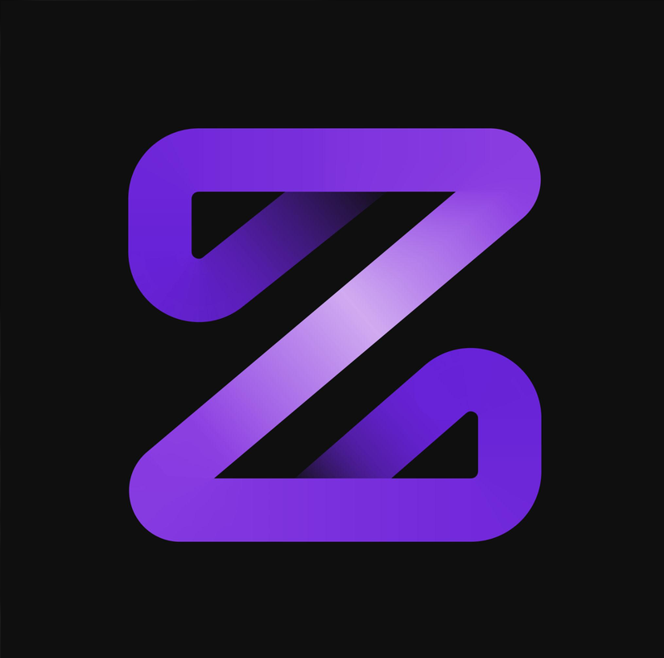
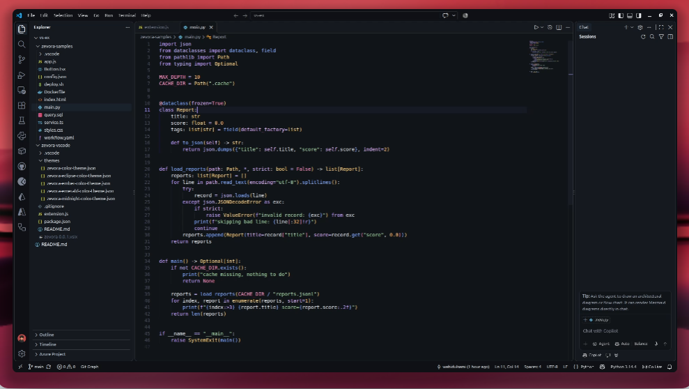
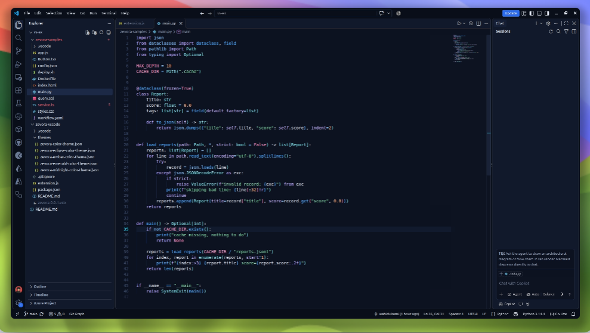
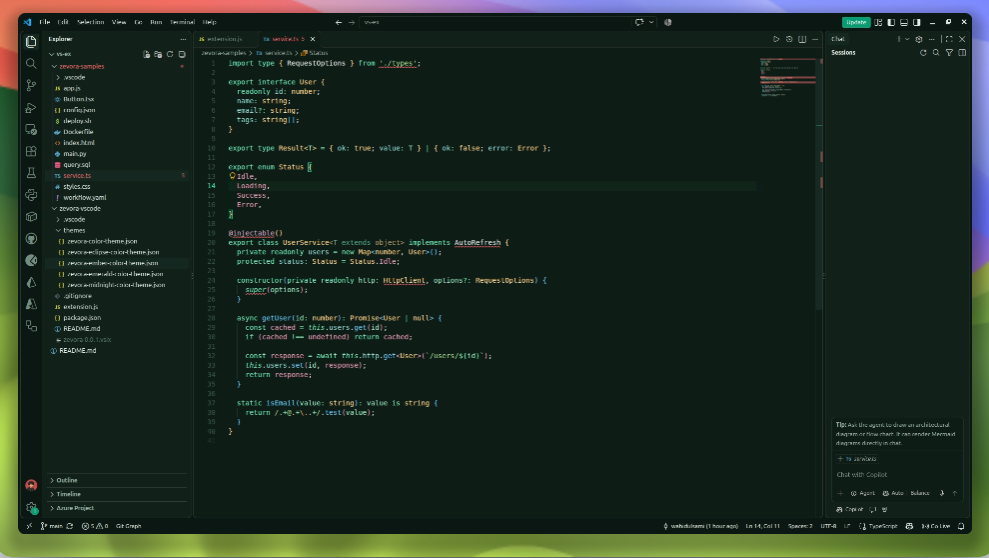
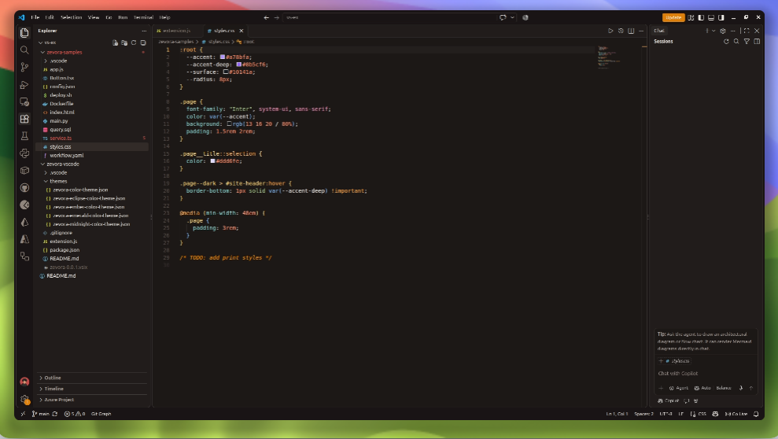

<div align="center">

  

  # Zevora

  ### ✨ An elegant, hyper-focused dark theme suite for VS Code ✨

  A carefully crafted family of high-contrast, eye-friendly dark color themes designed for modern developers.<br/>
  Featuring signature accents, balanced syntax highlighting, and an integrated quick-switcher.

  <p>
    <a href="https://marketplace.visualstudio.com/items?itemName=Zevora.zevora"></a>
    <a href="https://github.com/wahidulsami/Zevora/releases"></a>
    <a href="LICENSE"></a>
    <a href="https://github.com/wahidulsami/Zevora"></a>
  </p>

  <p>
    <a href="#-themes-showcase">Themes Showcase</a> •
    <a href="#-palette-at-a-glance">Color Palette</a> •
    <a href="#-quick-theme-switcher">Quick Switcher</a> •
    <a href="#-installation">Installation</a> •
    <a href="#-recommended-settings">Recommended Settings</a> •
    <a href="#-contributing">Contributing</a>
  </p>

</div>

---

## 🎨 Themes Showcase

Zevora provides **5 distinct flavor profiles** to match your mood, workflow, and aesthetic preference throughout the day and night:

### 1. 🌙 Zevora Dark (Signature)
> Deep charcoal backdrop paired with a soft neon-purple accent system. Tuned for clean contrast without eye fatigue.



* **Base**: `#0D1014` • **Accent**: `#A78BFA` • **Keywords**: `#C4A1FF` • **Functions**: `#82AAFF`

---

### 2. 🌌 Zevora Midnight
> Deep navy abyss infused with vivid cyan and electric blue accents, balanced by dreamy lavender keywords.



* **Base**: `#0A0F1C` • **Accent**: `#22D3EE` • **Keywords**: `#B9A6FF` • **Functions**: `#4DAAFF`

---

### 3. 🍃 Zevora Emerald
> Deep forest night illuminated by radiant emerald, fresh mint, and warm yellow tokens. Calm, refreshing, and crisp.



* **Base**: `#0A1712` • **Accent**: `#10B981` • **Keywords**: `#6EE7B7` • **Functions**: `#66C7F0`

---

### 4. 🌋 Zevora Ember
> Warm dark charcoal with glowing amber, coral highlights, and soft peach tones. Ideal for cozy, late-night code flow.



* **Base**: `#171312` • **Accent**: `#FFAE57` • **Keywords**: `#FFA94D` • **Functions**: `#7EB8F0`

---

### 5. 🌑 Zevora Eclipse
> Near-black obsidian backdrop with sharp glowing orange and steel blue syntax elements for maximum focus and contrast.


* **Base**: `#0A0A0F` • **Accent**: `#FF9E64` • **Keywords**: `#6B9FE8` • **Functions**: `#FF9E64`

---

## 📊 Palette at a Glance

All five variants share a unified syntax hierarchy (keywords, functions, strings, numbers, types, constants, parameters, properties, operators, comments, decorators, and diff colors) so switching variants keeps everything familiar while altering the atmospheric tone:

| Theme Variant | Editor Background | Cursor / Accent | Keywords | Functions | Strings | Types |
| :--- | :---: | :---: | :---: | :---: | :---: | :---: |
| **Zevora Dark** | `#0D1014` | `#A78BFA` | `#C4A1FF` | `#82AAFF` | `#A8DCA8` | `#FFD580` |
| **Zevora Midnight** | `#0A0F1C` | `#22D3EE` | `#B9A6FF` | `#4DAAFF` | `#82D9A6` | `#7FE0E8` |
| **Zevora Emerald** | `#0A1712` | `#10B981` | `#6EE7B7` | `#66C7F0` | `#A5D98A` | `#FFD98A` |
| **Zevora Ember** | `#171312` | `#FFAE57` | `#FFA94D` | `#7EB8F0` | `#A8C98A` | `#FFD97A` |
| **Zevora Eclipse** | `#0A0A0F` | `#FF9E64` | `#6B9FE8` | `#FF9E64` | `#98C379` | `#E5C07B` |

---

## ⚡ Built-in Quick Theme Switcher

Switch between Zevora themes in a single step without scrolling through your entire theme library:

1. Press `Ctrl + Shift + P` (or `Cmd + Shift + P` on macOS).
2. Run **`Zevora: Switch Theme`**.
3. Pick your desired flavor from the Quick Pick list.

> 💡 **Zero Overhead**: The extension only activates when the switcher command is triggered. It has zero background processes, zero telemetry, and zero runtime dependencies.

---

## 🚀 Installation

### Option A: From VS Code Marketplace (Recommended)

1. Open VS Code and press `Ctrl + Shift + X` to open the Extensions view.
2. Search for **Zevora**.
3. Click **Install**.

Or install from the command line:
```bash
code --install-extension Zevora.zevora
```

[](https://marketplace.visualstudio.com/items?itemName=Zevora.zevora)

### Option B: From VSIX (Local install)

Run in your terminal:
```bash
code --install-extension zevora-0.0.1.vsix
```

> **Using a VS Code fork (Antigravity IDE, Cursor, VSCodium)?**
> Open the Extensions view (`Ctrl+Shift+X`) → Click the **`···`** menu at the top-right → Select **Install from VSIX...** → Choose `zevora-0.0.1.vsix`. Run **Developer: Reload Window** if needed.

### Option C: From Source (Development)

1. Clone the repository:
   ```bash
   git clone https://github.com/wahidulsami/Zevora.git
   cd Zevora/zevora-vscode
   ```
2. Open in VS Code:
   ```bash
   code .
   ```
3. Press `F5` to launch an **Extension Development Host** to preview and tweak live.

---

## 🛠️ Recommended Editor Settings

For the cleanest aesthetic and optimal typography, add these settings to your `settings.json`:

```json
{
  "editor.fontFamily": "'JetBrains Mono', 'Fira Code', 'Cascadia Code', monospace",
  "editor.fontLigatures": true,
  "editor.fontSize": 14.5,
  "editor.lineHeight": 1.6,
  "editor.cursorBlinking": "smooth",
  "editor.cursorSmoothCaretAnimation": "on",
  "editor.bracketPairColorization.enabled": true,
  "editor.guides.bracketPairs": "active",
  "editor.semanticHighlighting.enabled": true,
  "workbench.iconTheme": "material-icon-theme"
}
```

---

## 📦 Packaging

To bundle the extension into a `.vsix` file:

```bash
cd zevora-vscode
npx @vscode/vsce package
```

---

## 🤝 Contributing

Contributions, feedback, and suggestions are welcome!

1. Fork the Project
2. Create your Feature Branch (`git checkout -b feature/NewVariant`)
3. Commit your Changes (`git commit -m 'Add new variant or refine tokens'`)
4. Push to the Branch (`git push origin feature/NewVariant`)
5. Open a Pull Request

---

## 📄 License

Distributed under the MIT License. See `LICENSE` for more information.

<div align="center">

Crafted with 💜 by [Wahidul Islam Sami](https://github.com/wahidulsami)

**Enjoying Zevora? Give it a ⭐ on [GitHub](https://github.com/wahidulsami/Zevora)!**

</div>
